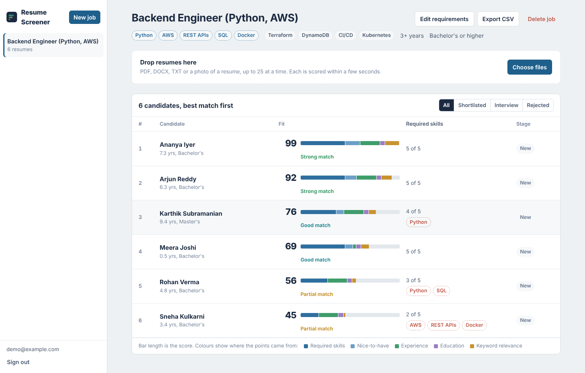
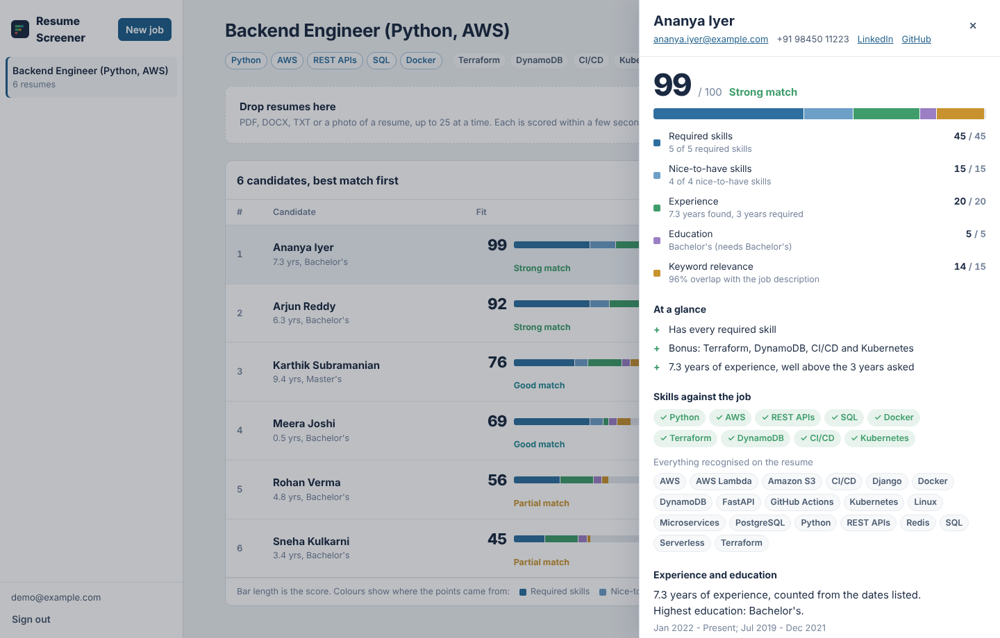
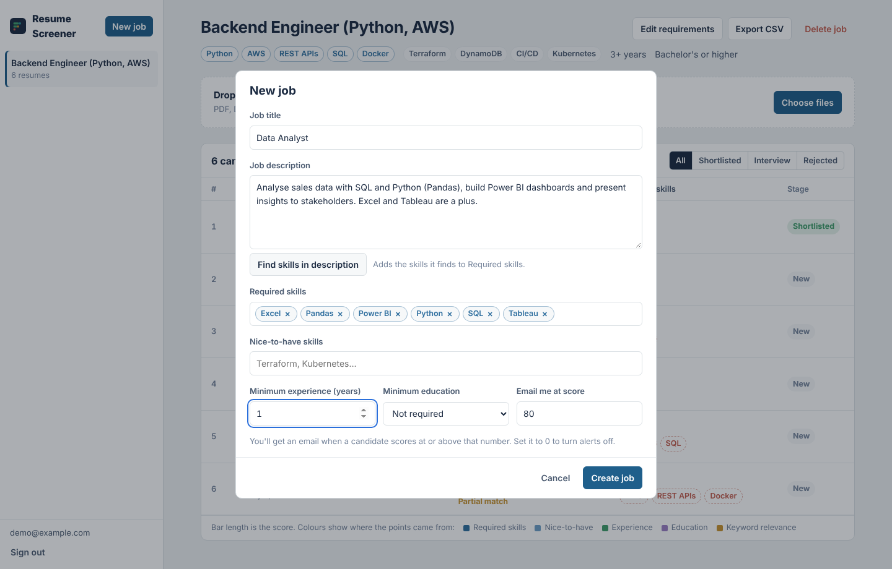
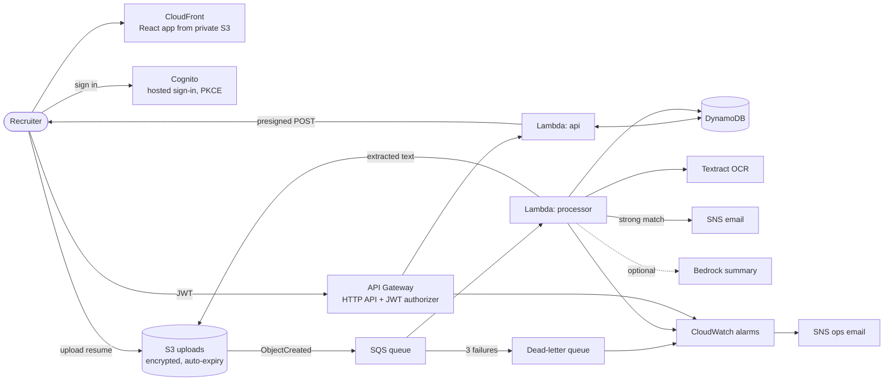

# Resume Screener

A serverless resume screening app on AWS. A recruiter creates a job, drops in a stack of resumes, and each one is read, scored against the job's requirements and ranked within seconds, with the reasons for every score laid out so the shortlist is easy to trust.

**Stack:** AWS Lambda (Python 3.13) · API Gateway · S3 · SQS + DLQ · DynamoDB · Cognito · Textract · SNS · CloudFront · CloudWatch · Terraform · React 19 + TypeScript · GitHub Actions (OIDC)



---

## What it does

- **Explainable scores.** Every candidate gets 0-100 built from required skills, nice-to-have skills, years of experience, education and keyword relevance. The bar on each row is the score split into those parts, so you can see *why* someone ranked where they did.
- **Reads real resumes.** Text-based PDFs (pypdf), Word documents, plain text, and photos or scanned resumes (Amazon Textract OCR).
- **Understands skill names.** `k8s` = Kubernetes, `ReactJS` = React, Django implies Python, and "Java" doesn't match "JavaScript". Words like "Go" or "Rust" only count when used as a skill name, not in "go to market".
- **Experience from dates.** It adds up job date ranges ("Jan 2021 – Present"), merges overlaps, and ignores degree dates. If there are no dates, it falls back to a statement like "5+ years of experience".
- **Re-ranks instantly.** Change the job's requirements and every candidate is re-scored from the stored text, with no re-upload needed.
- **Recruiter workflow.** Shortlist, interview or reject candidates, keep private notes, open the original resume, and export the ranking as CSV.
- **Alerts.** An email arrives when a candidate scores above the job's threshold.
- **Optional AI summary.** Turn on Amazon Bedrock for a 3-bullet strengths/gaps/interview-question summary per candidate.

| Candidate detail | New job with skill detection |
|---|---|
|  |  |

---

## Architecture



**Why it's built this way**

- **Uploads skip the API entirely.** The API returns a presigned S3 POST form and the browser uploads directly to S3. S3 itself enforces the 5 MB limit (`content-length-range`), so Lambda never handles file bytes.
- **S3 → SQS → Lambda, not S3 → Lambda.** The queue absorbs bursts (25 files at once) and retries transient failures. After 3 attempts a message moves to a dead-letter queue, which triggers an alarm. The processor uses partial batch responses, so one bad message doesn't retry the whole batch.
- **Bad files vs. broken systems.** A corrupt or unsupported file marks the candidate `FAILED` with a readable reason and is not retried. Anything else (throttling, timeouts) raises and goes through SQS retries.
- **Single-table DynamoDB.** Jobs are partitioned by recruiter (`USER#<sub>`), so one recruiter can't read another's jobs. Candidates are partitioned by job (`JOB#<id>`), so ranking a job is a single Query.
- **Least privilege.** Each Lambda has its own IAM role scoped to the exact table, bucket prefixes, queue and topic it uses.
- **Privacy by default.** The buckets are private and encrypted, only HTTPS is allowed, and resumes and extracted text are deleted automatically after 90 days. Download links expire in 5 minutes. Scoring ignores name, gender, age, photo and location.

### Scoring

| Component | Default weight | How it's measured |
|---|---|---|
| Required skills | 45 | Share of the job's required skills found on the resume |
| Nice-to-have skills | 15 | Share of bonus skills found |
| Experience | 20 | Years found ÷ years required (capped at 100%) |
| Education | 5 | Meets the minimum degree (half credit one level below) |
| Keyword relevance | 15 | Cosine similarity of job description and resume terms (unigrams + bigrams) |

If a job doesn't set a criterion (for example, no minimum experience), its weight is shared among the others. Tiers: 80+ strong, 65+ good, 45+ partial.

---

## Run it locally (no AWS account needed)

The local server runs the real Lambda handlers against an in-memory AWS simulation ([moto](https://github.com/getmoto/moto)).

```bash
# Backend
cd backend
python -m venv .venv && source .venv/bin/activate      # Windows: .venv\Scripts\activate
pip install -r requirements-dev.txt
python local_server.py --seed                          # http://localhost:8001

# Frontend (second terminal)
cd frontend
cp .env.example .env.local
npm install
npm run dev                                            # http://localhost:5173
```

Sign in as `demo@example.com` to see a sample job with six fictional resumes already scored, or upload your own from `samples/`. Locally, OCR for images isn't available and data is lost when the server stops.

### Tests

```bash
cd backend && pytest          # 48 tests: skills, parsing, scoring, extraction, full API + processor flow on mocked AWS
cd frontend && npm run lint && npm run build
```

CI runs these plus `terraform fmt` and `terraform validate` on every push.

---

## Deploy to AWS

### 1. Create an AWS account safely

New AWS accounts start on the **Free plan**: $100 in credits, plus up to $100 more for completing getting-started tasks, for up to 6 months. Your card isn't charged on this plan. Lambda (1M requests/month) and DynamoDB (25 GB) are always free. ([AWS Builder Center](https://builder.aws.com/content/3BlPcDGddaB6WkPvUf1LIy1rzIm/everything-you-need-to-know-to-get-started-with-aws-free-tier))

1. Sign up at [aws.amazon.com](https://aws.amazon.com/) and choose the Free plan.
2. Turn on MFA for the root user. Then create an IAM user with MFA for daily work and stop using root.
3. Don't enable AWS Organizations, Control Tower or IAM Identity Center on the Free plan. Doing so ends the free credits and moves the account to the paid plan.
4. Install the [AWS CLI](https://docs.aws.amazon.com/cli/latest/userguide/getting-started-install.html) and run `aws configure` with that user's access keys.
5. Install [Terraform](https://developer.hashicorp.com/terraform/install) 1.10 or newer.

For a demo with a few hundred resumes, the cost is a few cents a month and fits within the credits. Terraform also creates a **$5 monthly budget** that emails you at 80% of actual spend and 100% of forecast spend.

### 2. Deploy

```bash
cp infra/terraform.tfvars.example infra/terraform.tfvars   # set alert_email
./scripts/deploy.sh
```

The script builds the Lambda bundle, runs `terraform apply` (about 5 minutes, mostly CloudFront), writes the frontend config from Terraform outputs, uploads the site, and prints the app URL. Confirm the two SNS subscription emails AWS sends you. Then open the URL and choose **Create an account**.

To remove everything: `cd infra && terraform destroy`.

### 3. Optional: AI summaries with Bedrock

In the Bedrock console, enable model access for the model in `bedrock_model_id` (Claude 3 Haiku by default). Then set `enable_bedrock = true` and redeploy. This is pay-per-use and not free tier, but it costs well under a cent per resume.

### 4. Optional: deploy from GitHub Actions

`infra/bootstrap` creates an S3 state bucket and an IAM role that only this repository's `main` branch can assume through GitHub OIDC, so no AWS keys are stored in GitHub.

```bash
cd infra/bootstrap
terraform init && terraform apply -var github_repository=<owner>/resume-screener
```

Add repository variables `AWS_ROLE_ARN` and `TF_STATE_BUCKET` (from the outputs) and optionally `ALERT_EMAIL`, then run the **Deploy** workflow.

---

## Project layout

```
backend/
  src/screener/     scoring.py, skills.py, parsing.py, extract.py, pipeline.py, store.py, config.py
  src/handlers/     api.py (HTTP API), processor.py (SQS)
  tests/            pytest on moto-mocked AWS
  local_server.py   run everything locally
frontend/src/       React app: auth.ts (Cognito PKCE), api.ts, components/
infra/              Terraform: storage, queue, lambda, api, auth, frontend, monitoring
infra/bootstrap/    GitHub OIDC role + remote state
scripts/            build_lambda.sh, deploy.sh, make_samples.py
samples/            fictional resumes and a sample job
```

## Limitations and next steps

- Scoring is rule-based and transparent by design. It can miss skills phrased unusually, so treat scores as a sorting aid, not a decision.
- Scanned resumes must be single-page (synchronous Textract). Multi-page scans would need the asynchronous Textract API.
- Next: async Textract for long scans, semantic matching with embeddings (Bedrock Titan), team workspaces, and a custom domain with ACM.

*All people in `samples/` are fictional.*
